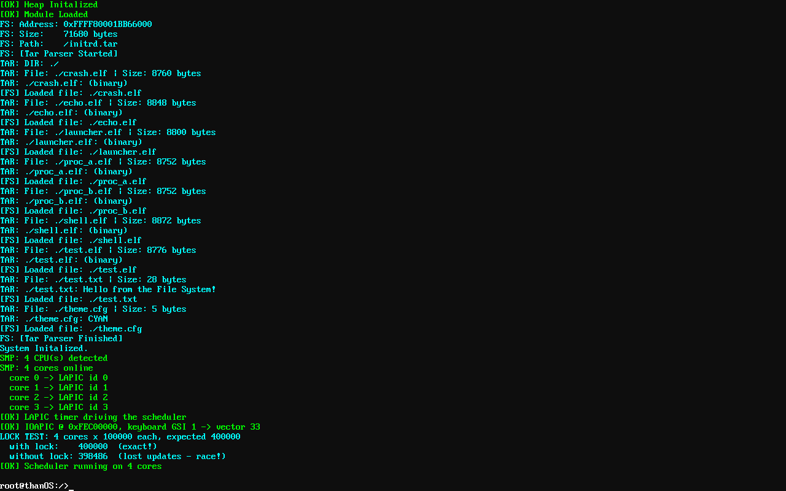
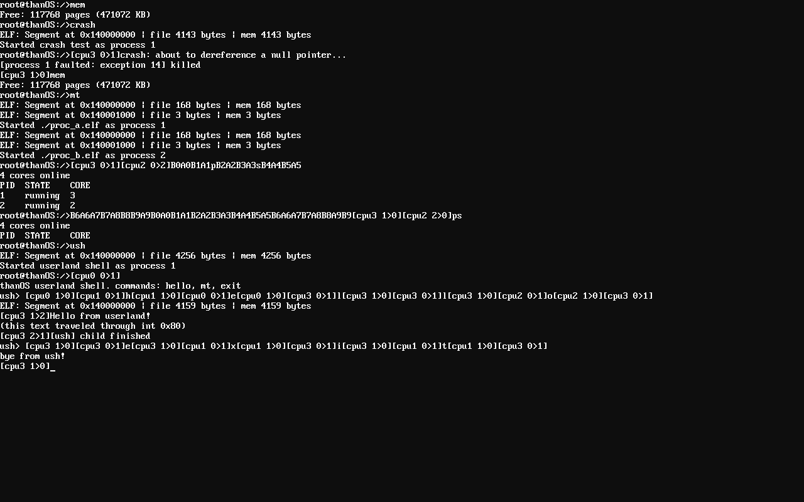

# thanOS

A 64-bit x86 kernel written from scratch in freestanding C++ with a little
assembly. No libc, no STL. It boots every core through Limine, runs ring-3
programs in their own address spaces, and schedules them preemptively across
all of the cores.



## What works

**Memory**
- Bitmap physical page allocator.
- 4-level paging. Each process gets its own PML4; the kernel half is shared and
  CR3 is switched in the scheduler, so every program links at the same virtual
  address.
- Kernel heap: a free list that splits and coalesces blocks, behind `malloc` /
  `free` and `operator new` / `delete`.

**Processes**
- ELF64 loader, and ring 3 through user segments in the GDT plus a TSS per core.
- Syscalls over `int 0x80` with Linux's numbers: `read`, `write`, `exit`,
  `wait`, and a `spawn` that stands in for fork + exec.
- Preemptive round-robin scheduling on every core. Each core has its own LAPIC
  timer and pulls from one shared run queue, so processes run in parallel and
  move between cores. `read()` and `wait()` block, and the process is woken by
  a keypress or a child exiting.
- Fault isolation: a process that faults is killed and the kernel keeps
  running. On exit its pages, page tables and PML4 are freed.
- `ush`, a shell that runs in ring 3 and reads input and launches children
  using nothing but syscalls.

**Interrupts and SMP**
- GDT, IDT, exception handlers, PS/2 keyboard.
- All cores are started through Limine's MP protocol, each with its own TSS,
  kernel stack and local APIC.
- The legacy PIC is retired: the LAPIC timer is calibrated against the PIT, and
  the keyboard is routed through the IOAPIC, which is located by parsing the
  ACPI MADT.
- Spinlocks (plain, interrupt-safe, and a re-entrant one for the terminal)
  guard the page allocator, the heap and the scheduler.
- Keyboard input crosses from the interrupt handler to the kernel's main loop
  through a lock-free SPSC ring. The handler only queues the key; running the
  shell command or waking the process blocked in `read()` happens outside
  interrupt context.
- Moving a process between cores is cheap because the kernel keeps no
  per-process stack: a process is its saved register frame plus its page
  tables, so a core that parks one can hand it to any other core on the next
  tick. A core with nothing to run sits in its own idle loop.
- Before the scheduler starts, every core runs a lock contention test (the
  `LOCK TEST` lines in the screenshot above).

**Storage**
- An initrd: a tar archive loaded as a Limine module and exposed through a
  small VFS. User programs are loaded from it.
- ATA PIO driver, MBR parsing and read-only FAT32 (single-cluster files for
  now).

**The rest**
- Framebuffer text renderer with an 8x16 bitmap font, and a `printf`.
- `String` and `Vector`, since there is no standard library to lean on.

## A session



- `crash` starts a program that dereferences a null pointer. The page fault
  kills that process only, and `mem` reports the same free page count before
  and after.
- `mt` starts two CPU-bound programs. Cores 3 and 2 pick them up and run them
  at the same time. `ps`, typed on core 0 while they are running, shows each on
  its own core.
- `ush` starts the userland shell. Every time it blocks in `read()` and wakes,
  whichever core ticks first takes it, so it hops between cores. `hello` there
  spawns a child and waits for it; the child's output reaches the screen
  through `int 0x80`.
- The `[cpu3 0>1]` markers are the scheduler tracing its context switches:
  the core, the slot it was running, the slot it runs next (0 is idle).
- Not shown: `mount`, `ls` and `cat` read the FAT32 partition on the attached
  disk.

## Build and run

You need an `x86_64-elf` cross toolchain (g++ and ld), `nasm`, `xorriso`, QEMU,
and `parted`, `dosfstools` and `mtools` for the FAT32 test disk.

```sh
make -C Limine   # once, builds the limine host tool
make run         # builds the kernel + user programs, makes the ISO and disk, boots QEMU with 4 cores
```

## Layout

```
src/cpu/       GDT, IDT, interrupts, physical and virtual memory, syscalls, APIC, IOAPIC, SMP, locks
src/proc/      processes and the scheduler
src/memory/    kernel heap
src/loader/    ELF loader
src/fs/        tar initrd, VFS, MBR, FAT32
src/drivers/   keyboard, ATA, legacy PIC
src/utils/     port I/O, the SPSC ring
src/graphics/  framebuffer text renderer
src/std/       String, Vector
src/shell/     the in-kernel shell
user/          ring-3 programs and the syscall wrappers they use
```

## Next

- [ ] Reschedule IPIs, so an idle core takes new work at once instead of on
      its next tick
- [ ] Per-core run queues
- [ ] Growable heap
- [ ] FAT32 cluster chains and write support
- [ ] Network stack (e1000, then ARP/ICMP, UDP, TCP)
- [ ] Doom
